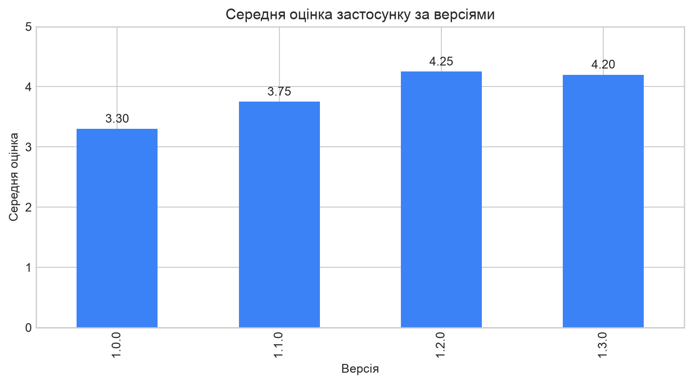
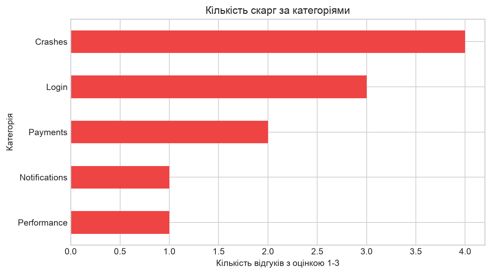

# Аналіз відгуків про застосунок

> Бейдж **Open in Colab** потрібно активувати після публікації репозиторію в GitHub. Готову адресу та всі потрібні дії наведено в `docs/GitHub_actions_required.md`.

## Опис проєкту

Навчальний мініпроєкт до лабораторної роботи 11. Виконується аналіз 36 синтетичних відгуків про застосунок засобами Python, pandas і matplotlib.

## Структура репозиторію

- `notebooks/lab_analysis.ipynb` - виконаний notebook з аналізом;
- `data/app_reviews.csv` - навчальний синтетичний набір даних;
- `docs/` - діаграми та супровідні матеріали.

## Як запустити

1. Відкрийте `notebooks/lab_analysis.ipynb` у Google Colab або Jupyter.
2. Збережіть структуру папок і виконайте всі комірки послідовно.
3. Для Colab завантажте CSV або після публікації репозиторію замініть локальний шлях на raw URL файлу `data/app_reviews.csv`.

## Дані

Набір вигаданий і не містить персональних даних. Поля: `review_id`, `rating`, `category`, `length`, `version`.

## Результати

Середня оцінка порівнюється між версіями застосунку, а відгуки з оцінкою 1-3 аналізуються як скарги за категоріями.

## Висновки

У синтетичному наборі середня оцінка зростає від 3.30 у версії 1.0.0 до піку 4.25 у версії 1.2.0, а у 1.3.0 трохи знижується до 4.20. Категорія `Crashes` має найбільше скарг, отже потребує першочергової перевірки.

## Автор

Климюк Назарій, група ПІ-25-02, варіант 10.
